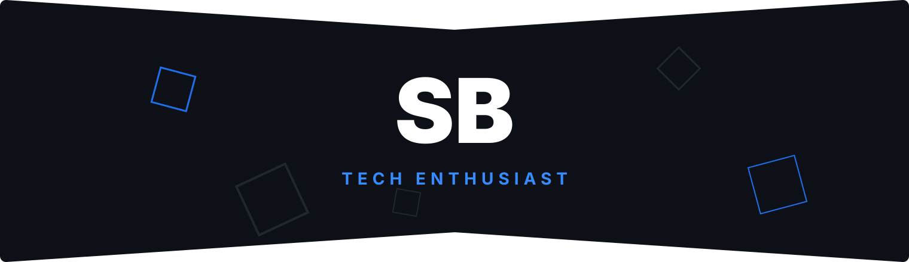

  

<h3 align="center">Hi, Human 🖖</h3>

  <b>I'm Sauryaman, a developer passionate about this amazing world of technology.</b>
    
  Welcome to my GitHub, here you will find my projects and my collaborations..

 

  <i>You can find me or contact me through these networks:</i>
    
  
  
   
  
  

 

  <i>Languages and Tools I use:</i>
    
  
  
  
  
    

---

  
More about me

   
  I'm a self-taught student, introverted and very observant. 
  I'm currently contributing to the open source world to put into practice the knowledge acquired in my studies. I also help the guys who are starting programming in the communities.
    
  <ul>
    <li>🎓 Technician in System Development by ETEC</li>
    <li>🎯 Contribute and create open source projects</li>
    <li>📚 I'm studying Python | Algorithms | Dev Web | English</li>
    <li>💬 You can ask me questions, I like to help!</li>
    <li>🌑 Observing space</li>
    <li>🎮 Find me in the gaming world: <b>TheuzzLivee</b></li>
  </ul>

  
My GitHub stats

   
  

    
  

 

  

